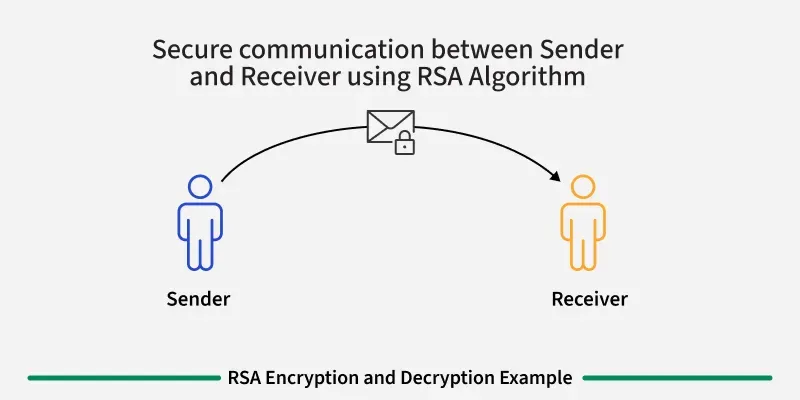

# Introduction

The RSA algorithm named after the initials of it's 3 inventors (**R**ivest-**S**hamir- **A**dleman) is an **asymmetric** encryption algorithm or **public-key cryptography** algorithm which means it works on two different keys:
- Public key: A key which is known to everyone and used for encryption 
- Private key: A private key used for decryption and must be kept secret by the receiver

RSA Algorithm is named after Ron Rivest, Adi Shamir and Leonard Adleman, who published the algorithm in 1977.

## Example of Asymmetric Cryptography

If Person **A** wants to send a message securely to Person **B**

- Person A **encrypts** the message using Person B's **Public** Key.
- Person B **decrypts** the message using their **Private** Key.

## Why encryption is crucial in today's digital world

Whenever you visit a secure website (the padlock in the address bar), send a password, or make an online payment, encryption is what keeps that data safe in transit. Without it, anyone eavesdropping on the network could read your messages as plaintext. Asymmetric schemes like RSA are the foundation of protocols such as TLS that secure the modern internet.

# RSA Algorithm

RSA Algorithm is based on **factorization** of large number and  **modular arithmetic** for encrypting and decrypting data. It consists of three main stages:

1. **Key Generation:** Creating Public and Private Keys
2. **Encryption:** Sender encrypts the data using Public Key to get **cipher text**.
3. **Decryption:** Decrypting the **cipher text** using Private Key to get the original data.
## Key generation
- Choose two large prime numbers, say **p** and **q**. These prime numbers should be kept secret.
- Calculate the product of primes, **n = p * q**. This product is part of the public as well as the private key.
- Calculate the Euler Totient function 
$$
\phi(n)=n \prod_{p \mid n}\left(1-\frac{1}{p}\right)
$$
this function simplifies to 

$$\phi(p) = p - 1 $$
when p is **prime**

- Choose encryption exponent **e**, such that
    - 1 < e < $\phi(n)$, and
    - gcd(e, $\phi(n)$) = 1, that is e should be co-prime with $\phi(n)$.
- Calculate decryption exponent **d,** such that
    - **(d * e) ≡ 1 mod $\phi(n)$**, that is d is [modular multiplicative inverse](https://www.geeksforgeeks.org/dsa/multiplicative-inverse-under-modulo-m/) of **e** mod $\phi(n)$. Some common methods to calculate multiplicative inverse are: [Extended Euclidean Algorithm](https://www.geeksforgeeks.org/dsa/euclidean-algorithms-basic-and-extended/), [Fermat's Little Theorem](https://www.geeksforgeeks.org/dsa/fermats-little-theorem/), etc.
    - We can have multiple values of d satisfying **(d * e) ≡ 1 mod $\phi(n)$** but it does not matter which value we choose as all of them are valid keys and will result into same message on decryption.

Finally, the **Public Key = (n, e)** and the **Private Key = (n, d)**.

## Encryption
To encrypt a message **M**, it is first converted to numerical representation using ASCII and other encoding schemes. Now, use the public key (n, e) to encrypt the message and get the cipher text using the formula:
$$
C=M^e(\bmod n)
$$
 where C is the Cipher text and e and n are parts of public key.
## Decryption
To decrypt the cipher text **C**, use the private key (n, d) and get the original data using the formula:
$$
M=C^d(\bmod n)
$$
 where M is the message and d and n are parts of private key.

# Idea behind RSA

The security of RSA rests on a single, asymmetric fact: **multiplying is easy, factoring is hard.**

- Given two primes $p$ and $q$, anyone can quickly compute their product $n = p \cdot q$. This is a fast operation.
- But given only the huge product $n$, **recovering** the original primes $p$ and $q$ is computationally infeasible for large $n$ (hundreds of digits).

The public key $(n, e)$ is published openly, yet the private key $(n, d)$ stays secret because computing $d$ requires knowing $\phi(n)$, which in turn requires knowing $p$ and $q$. Since factoring $n$ is impractical, an attacker cannot derive the private key from the public key.

In short: the trapdoor that lets the *intended* receiver decrypt is the knowledge of the factorization of $n$. Everyone else faces an intractable factoring problem.

## Why it's hard to crack RSA

1. **The hardness of factoring.** The best-known general-purpose algorithms (e.g. the General Number Field Sieve) have sub-exponential but still impractically long runtimes for the sizes used in practice.
2. **Key size matters.** Modern RSA uses keys of at least 2048 bits, making brute-force search over factorizations astronomically infeasible.
3. **No known polynomial-time factoring algorithm.** Despite decades of effort, nobody has found an efficient way to factor arbitrary large integers on classical computers.

> ⚠️ A caveat worth knowing: RSA's security relies on the *conjecture* that factoring is hard. A sufficiently large **quantum computer** could factor integers efficiently using Shor's algorithm, which is why the field is gradually moving toward **post-quantum cryptography**.

For more on the systems and protocols that rely on secure, standardised communication — and how modern applications connect to tools and data — see [[MCP protocol|MCP protocol]].

---

## Summary

RSA lets two parties communicate securely without ever sharing a secret key ahead of time:

| Stage | Uses | Result |
| ----- | ---- | ------ |
| Key generation | $p, q, \phi(n), e, d$ | Public key $(n, e)$, Private key $(n, d)$ |
| Encryption | Public key $(n, e)$ | Ciphertext $C = M^e \bmod n$ |
| Decryption | Private key $(n, d)$ | Message $M = C^d \bmod n$ |

Its security comes from the one-way trapdoor: easy to compute $n$ and encrypt, infeasible to reverse without the factorization.

## Related notes

- [[MCP protocol]] — how systems connect, where secure communication and protocols matter.
- [[My Digital Garden|Back to home]] — browse the rest of the garden.
