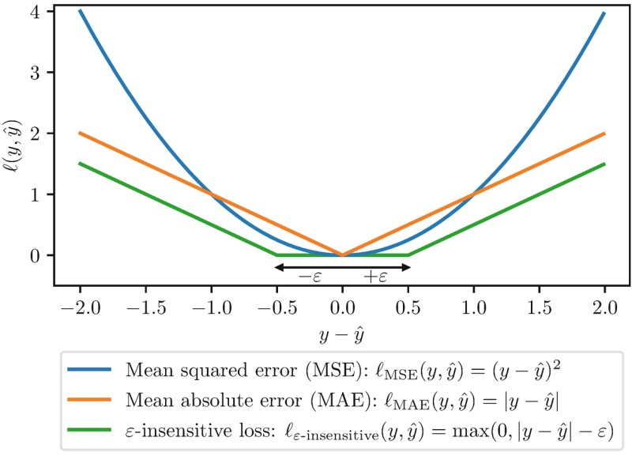
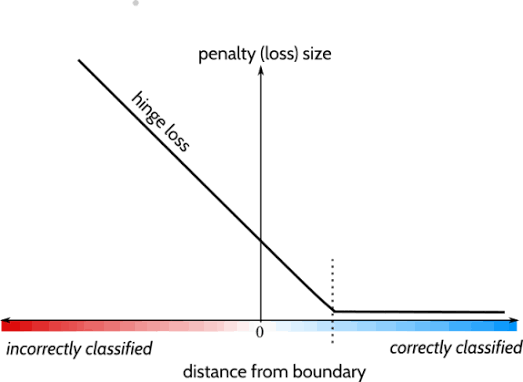

# Introduction

When training any machine learning model, we need a way to measure how wrong its predictions are. This is where the **loss function** comes in. Think of it as a scoreboard that tells the model how far off it is from the correct answer.

A loss function takes every prediction the model makes and compares it against the true value, producing a single number that quantifies the overall error. The training process then adjusts the model to **minimize** this number, just like a blindfolded maze-walker using "warmer" and "colder" taps to home in on the exit.

Without a good loss function, a model has no clear signal to improve — so choosing the right one is one of the most important decisions in building a model.

## What makes a good loss function?
A good loss function should:
- Be **differentiable**, so we can compute gradients and update the model with gradient descent.
- Be **smooth**, so small changes in the model lead to small, predictable changes in the loss.
- Reflect how much the task actually cares about mistakes (sometimes wrong answers cost more than others).

---

# Regression Loss Functions

Regression models predict a **continuous** value, like a house price, temperature, or exam score. The loss depends on the **distance** between predicted values $\widehat{y}$ and true values $y$.

## Mean Squared Error (MSE)
The most common regression loss is the **mean squared error**, which averages the squared differences between predictions and true values.

$$MSE = \frac{1}{n} \sum_{i=1}^{n} \bigl(y_i - \widehat{y}_i\bigr)^2$$

- Squaring the errors **penalizes large mistakes** much more heavily than small ones.
- Because it is smooth and differentiable, it is easy to optimize with gradient descent.

> The downside: because it squares errors, it is **very sensitive to outliers** — a single extreme value can dominate the loss.

## Mean Absolute Error (MAE)
Instead of squaring the errors, **mean absolute error** sums their absolute values:

$$MAE = \frac{1}{n} \sum_{i=1}^{n} \Bigl| y_i - \widehat{y}_i \Bigr|$$

- It is **robust to outliers**, since no single error gets amplified by squaring.
- The tradeoff is that it is not differentiable at the point where the error is exactly zero, which can make optimization slightly trickier.

## Huber Loss — A Compromise
The **Huber loss** combines the best of both: it behaves like MSE for small errors and like MAE for large ones, controlled by a threshold $\delta$:

$$\mathcal{L}_{\text{Huber}} =
\begin{cases}
\frac{1}{2}(y - \widehat{y})^2 & \text{if } \bigl| y - \widehat{y} \bigr| \leq \delta \\
\delta \cdot \bigl( | y - \widehat{y} | - \frac{\delta}{2} \bigr) & \text{otherwise}
\end{cases}
$$

Where $\delta$ is a **hyperparameter** that decides where the loss switches from quadratic (sensitive) to linear (robust) behaviour.

- For errors smaller than $\delta$, it treats them like **squared errors**.
- For errors larger than $\delta$, it treats them like **absolute errors**, so outliers don't dominate.

---

# Classification Loss Functions

Classification models predict a **category** — for example, "spam" vs "not spam" or "pass" vs "fail". Here the loss depends on how confident the model is about the correct class.

## Cross-Entropy Loss
For classification, the most common loss is **cross-entropy**, which measures the difference between the model's predicted probability distribution and the true distribution:

$$\mathcal{L} = - \sum_{k=1}^{C} y_k \log \bigl( \widehat{y}_k \bigr)$$

where $C$ is the number of classes, $y_k$ is the true probability of class $k$, and $\widehat{y}_k$ is the predicted probability.

- If the model is very confident and **correct**, the loss is small.
- If the model is confident but **wrong**, the loss is huge — which strongly pushes the model to fix it.
- The $\log$ makes the loss **strongly reward even small improvements** in predictions that are currently very wrong.

For a single binary classification this reduces to the **binary cross-entropy**:

$$\mathcal{L} = - \Bigl[ y \log( \widehat{y} ) + (1 - y) \log( 1 - \widehat{y} ) \Bigr]$$

## Hinge Loss (Support Vector Machines)
Another classification loss is the **hinge loss**, used by Support Vector Machines. It tries to ensure the score for the correct class is higher than the scores of the incorrect classes by a margin:

$$\mathcal{L} = \max\bigl( 0, 1 - y \cdot \widehat{y} \bigr)$$

- It penalizes the model **only when the prediction is wrong or not confident enough**.
- If the model is already correct and confident, the loss is **zero**, so the model focuses effort elsewhere.

---

# Regularization
Loss functions alone choose a model, but sometimes the model **fits too well** to the training data. This is where [[Regularization]] comes in.

Regularization is a technique used in machine learning to improve the performance of models. Think of it like fine-tuning a radio to get a clear signal. When we build machine learning models, they might **overlearn** the details, including noise in the training data. Regularization helps to adjust the model so it focuses on the important patterns, making it more effective and versatile when dealing with new, unseen data.

## L1 and L2 Regularization

Technically, regularization avoids overfitting by adding a penalty to the model's loss function:

$$\text { Regularization }=\text { LossFunction }+ \text { Penalty }$$

The two most common penalties are:

### L1 — Lasso
L1 regularization adds a penalty proportional to the **absolute value** of the coefficients:

$$\text { Cost Function } = \text { Loss } + \lambda \sum_{j=1}^{p} \bigl| \beta_j \bigr|$$

> Lasso regression automatically performs **feature selection** by eliminating the least important features.

### L2 — Ridge
L2 regularization adds a penalty proportional to the **square** of the coefficients:

$$\text { Cost Function } = \text { Loss } + \lambda \sum_{j=1}^{p} \beta_j^2$$

> Ridge regularization reduces the coefficients but **does not set them to zero**.

## Choosing $\lambda$

- **Cross-Validation**: Evaluate different $\lambda$ values on a held-out validation set and choose the one that performs best.
- **Grid Search**: Systematically try many combinations of $\lambda$ values with cross-validation.
- **Random Search**: Sample the parameter space randomly and evaluate each candidate with cross-validation.

---

# Final Notes

A good loss function is the foundation of a well-trained model. When a model underfits or overfits, the loss function gives us the language to fix it:

- **Underfitting** (error too high on both training and test data) suggests the model is too simple.
- **Overfitting** (error very low on training but high on test data) suggests the model is memorizing noise, which regularization helps to correct.

The loss function not only tells the model *how good* its predictions are — combined with regularization, it tells the model **what kind of solutions to prefer**.