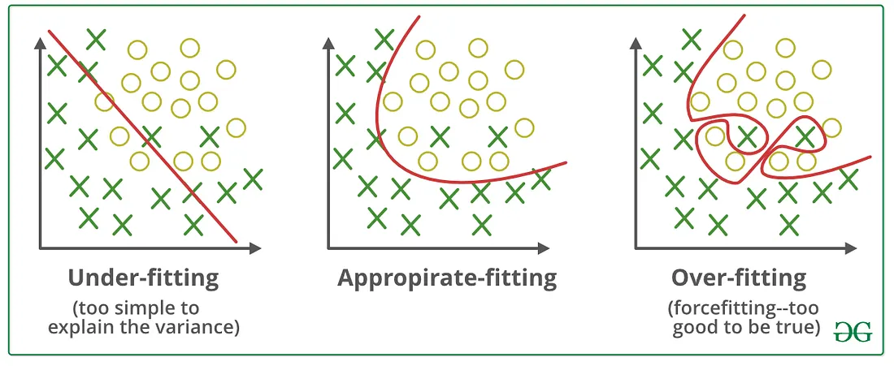

# Introduction

In the world of machine learning, oftentimes when you train a machine learning model, you find yourself dealing with the following situations:
Either your trained model doesn't learn from the training data, we say then that the model is **underfitting**
Or the model learns very well but it fails to generalize or give good predictions on unseen data, we call that **overfitting**

Clearly we should avoid both situations at all times, we should strive to have a model correctly fits the data and can make accurate predictions on unseen data.

Regularization is a technique used in machine learning to improve the performance of models. Think of it like fine-tuning a radio to get a clear signal. When we build machine learning models, they might **overlearn** the details, including noise in the training data. Regularization helps to adjust the model so it focuses on the important patterns, making it more effective and versatile when dealing with new, unseen data.

## Overfitting and Underfitting
### Overfitting

Overfitting is like memorizing answers for a test without understanding the concepts — the model performs well on the training data but fails to predict new data accurately.
The diagnostic is the following: 
- Accuracy on train set is very high (almost 99%)
- Accuracy on test set is low
### Underfitting

Underfitting, on the other hand, is like not studying enough, the model doesn't learn enough from the training data, leading to poor performance on both the training and new data.

Both situations are not ideal, and finding the right balance is crucial for a successful model.

## Bias and Variance
Bias and variance are two factors in machine learning that affect model performance.
### Bias
Bias is when a model has a predetermined, often incorrect assumption about the data, leading to errors in predictions. It's like wearing tinted glasses and seeing everything in a particular color.
### Variance
Occurs when a model is too sensitive to the specifics of the training data, including the noise. It's like trying to adapt to every minor change in your environment.

The goal is to minimize both bias and variance to create models that are accurate and reliable

# Regularization techniques
## What is Regularization

Regularization means restricting a model to avoid overfitting by shrinking some of the coefficient estimates to zero. When a model suffers from overfitting, we should control the model's complexity.
For example: If we wanted to model a linear relationship but we chose for our model a quadratic or an nth degree polynomial, regularization will allow us to set the coefficients of our model in the best way in order to model a linear relationship

 Technically, regularization avoids overfitting by adding a penalty to the model's loss function:
 $$
\text { Regulariation }=\text { LossFunction }+ \text { Penalty }
$$
There are three commonly used regularization technique, let's discuss all of them:

### L2- Ridge Regularization

L2 R. adds a penalty based on the square of the magnitude of the coefficients. Using the same analogy of dials, Ridge doesn't turn any dials to zero but makes them smaller. It helps to reduce the complexity of the model by making the coefficients smaller.

> It does not set coefficients to zero

Suppose our [Loss functions | loss function](Loss%20functions.md) is the **sum of squared residuals** (Also known as the **residual sum of squares RSS**)

$$
R S S=\sum_{i=1}^n\left(y_i-\widehat{y_i}\right)^2
$$
Apply L2 regularization to this loss function would give us the following formula:

$$
\text { Cost Function }=R S S+\lambda \cdot \sum_{j=1}^p \beta_j^2
$$
Where $\lambda$ is the **regularization parameter** which determines how strong the influence of the regularization is. A higher lambda value means more regularization, leading to smaller coefficients in the model, but too much can cause underfitting
And $B_j$ are the coefficients or weights of the model that correspond to each feature
and $p$ is the number of features or coefficients of the model.

### L1 — Lasso Regularization

Lasso regression also adds a penalty term to the cost function, but slightly different. L1 regularization makes some coefficients zero, meaning the model will ignore those features. Ignoring the least important features helps emphasize the model's essential features.

> Lasso regression automatically performs feature selection by eliminating the least important features.

$$
\text { Cost Function } =  R S S+\lambda \sum_{j=1}^p\left|\beta_j\right|
$$
### Elastic Net Regularization — L1 and L2 Regularization

Elastic Net combines both L1 and L2 Regularization. It adds both penalties (absolute value and square of the coefficients) to the model. This approach blends the **feature elimination from Lasso**  **and** the **feature shrinkage from Ridge**. Elastic Net is particularly useful when there are multiple features that are correlated with each other. It can maintain the balance between feature selection and feature shrinkage, making it a versatile choice for many models.

The formula is the following:
$$
\text { Cost Function: } R S S+\lambda_1 \cdot \sum_{j=1}^p \beta_j^2+\lambda_2 \sum_{j=1}^p\left|\beta_j\right|
$$
Where $\lambda_1$ and $\lambda_2$ are regularization hyperparameters

## How to choose the best values for $\lambda_1$ and $\lambda_2$ ?

- **Cross-Validation**: Use cross-validation to evaluate different combinations of $\lambda_1$ and $\lambda_2$ on a validation set. The combination that yields the best performance on the validation set is often a good choice.
- **Grid Search:** Systematically work through multiple combinations of $\lambda_1$ and $\lambda_2$ and use cross-validation to find the best one.
- **Random Search:** Randomly sample the space of parameters ($\lambda_1$ and $\lambda_2$) and use cross-validation to find the best values.
