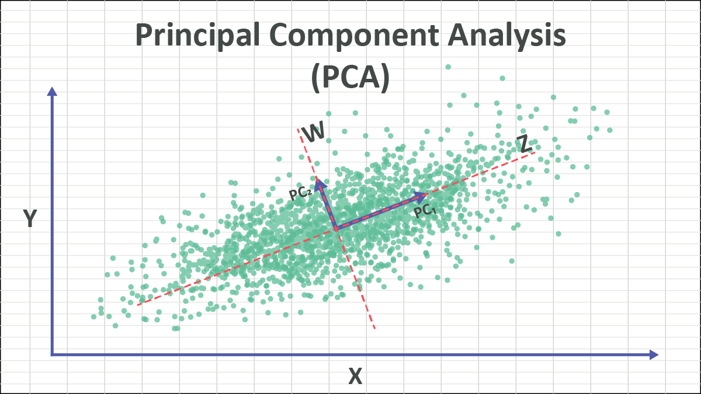

# What is PCA or Principal Component Analysis ?



**PCA** is a linear dimensionality reduction technique. Given data in ℝⁿ, it finds an **orthogonal basis** (principal components) ordered by the amount of variance they explain, so you can project onto the top-k directions and retain most of the information with far fewer dimensions.

It is often used as a preprocessing step before models that assume feature independence, such as [[The naive Bayes classifier|naive Bayes]].

## What PCA does ?
- **Dimensionality Reduction:** Compress 1000 features into 50 while keeping 95% of the information.
- **Decorrelation:** Transform correlated features into uncorrelated principal components.
- **Noise Filtering:** Lower PCs often capture noise; discarding them cleans the data.
- **Feature Extraction:** PCs can reveal hidden structure (clusters, patterns) not obvious in original features.

**Formally**: 
Given a centered data matrix $X$ (n samples × d features), compute the covariance matrix Σ = (1/n) XᵀX. 
The principal components are the **eigenvectors** of Σ, and the corresponding **eigenvalues** give the variance explained along each direction. Equivalently, PCA falls out of the SVD of X: X = UΣVᵀ, where the columns of V are the principal directions and the singular values relate to the eigenvalues of the covariance matrix (λᵢ = σᵢ²/n).
# Why is PCA useful? 

- **Dimensionality reduction**: compress high-dimensional data while preserving most variance — helps with the curse of dimensionality, speeds up downstream models, reduces overfitting risk.
- **Decorrelation**: the transformed features (principal components) are uncorrelated by construction, which can help algorithms that assume **feature independence** or are sensitive to multicollinearity (e.g., linear regression).
- **Visualization**: projecting to 2D/3D lets you eyeball structure/clusters in otherwise high-dimensional data.
- **Noise reduction**: low-variance components are often dominated by noise, so dropping them can act as a denoising step.
- **Preprocessing**: common before clustering, regression, or as a whitening step before other algorithms.


# PCA Algorithm

1. **Center the data** (subtract the mean of each feature; standardize/scale too if features have different units).
$$
z_{i j}=\frac{x_{i j}-\mu_j}{\sigma_j}
$$
2. **Compute the covariance matrix**
$$
\Sigma=\frac{1}{n-1} Z^T Z
$$
3. **Eigen decompose** Σ to get **eigenvectors** and **eigenvalues** (or just take the SVD of X directly — more numerically stable, avoids explicitly forming Σ).
4. **Sort eigenvectors** by descending eigenvalue.
5. **Select the top k** eigenvectors to form a projection matrix W (d × k).
6. **Project**:
$$
Y=Z W
$$

```python
import numpy as np

def pca(X, k):
    X_centered = X - X.mean(axis=0)
    # SVD is preferred over eig(cov) for numerical stability
    U, S, Vt = np.linalg.svd(X_centered, full_matrices=False)
    components = Vt[:k]                    # top-k principal directions
    X_reduced = X_centered @ components.T  # projected data
    explained_variance = (S**2) / (X.shape[0] - 1)
    explained_variance_ratio = explained_variance / explained_variance.sum()
    return X_reduced, components, explained_variance_ratio[:k]
```
In practice, you'd just use `sklearn.decomposition.PCA`:
```python
from sklearn.decomposition import PCA
from sklearn.preprocessing import StandardScaler

X_scaled = StandardScaler().fit_transform(X)
pca = PCA(n_components=k)
X_reduced = pca.fit_transform(X_scaled)
print(pca.explained_variance_ratio_)  # how much variance each PC captures
```

# Formulas and Properties
#### Covariance formula and definition
- Population Covariance
$$
\operatorname{Cov}(x, y)=\frac{\Sigma\left(x_i-\bar{x}\right)\left(y_i-\bar{y}\right)}{N}
$$
- Sample Covariance
$$
\operatorname{Cov}(x, y)=\frac{\Sigma\left(x_i-\bar{x}\right)\left(y_i-y\right)}{N-1}
$$
#### The Covariance Matrix
For a dataset with $d$ features, the covariance matrix Σ is a $d×d$ symmetric matrix:
$$
\Sigma=\frac{1}{n-1} X^T X
$$
