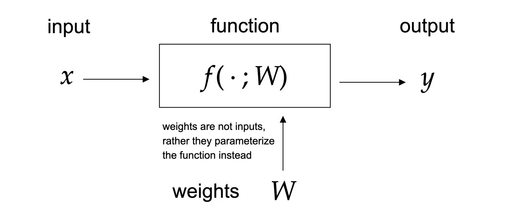
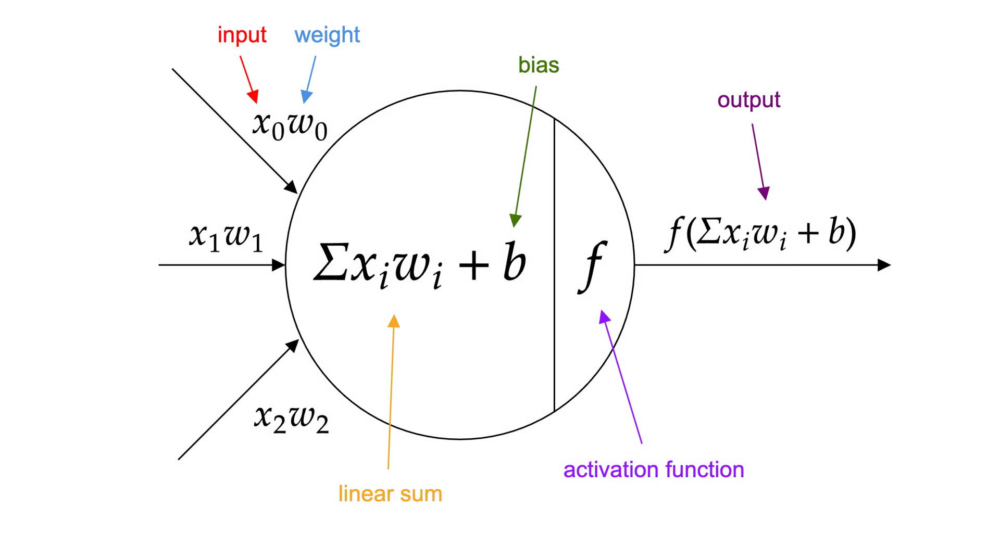

Imagine you were walking through a maze blindfolded. Once you take an incorrect turn, you feel a tap on your shoulder that'll tell you "warmer" or "colder" depending on whether you've gotten closer or further away from the exit of the maze.

Although you still cannot see the maze, you use this feedback to understand how far you are from the exit, eventually finding the correct route out. This is effectively the process of **backpropagation** in neural networks.

As a neural network trains, it does not find out what the ideal weights should be to form a solution. Rather, all it learns is just how "_wrong_" it was and makes corrections to reduce the errors it makes.

Backpropagation is the **calculus way** to convert each error signal into information used to update the model. It does this for every **parameter** (weight or bias) in every layer, quantifying how much each weight contributed to the error.
#  **Getting Into the Math**
To write this as a math equation, we represent the neural network as a **differentiable function** $f$:
$$
\hat{y}=f(x ; W)
$$

Above, **$x$** represents the input data fed into the neural network. For example, if the network was a language model, **$x$** might be a text prompt. But if the network were an image classifier, **$x$** would be an image.

**$W$** represents the weights or parameters in the neural network. Sometimes, people use the symbol **$\theta$(theta)** to represent parameters, including biases.

Parameters are effectively the "_dials_" that tell the network how to transform the input to reach an output as close as possible to the ideal solution.

The function, **$f(x;W)$**, is written in a notation that effectively says, "_Take the input data_ **$x$**, and manipulate it with weights_ **$W$**." The function _**f**_ is the model itself that makes a prediction, _**ŷ**_. This prediction is the estimate the model makes, aiming to get as close to the true value, _**y**_, as possible.

Putting this together, the equation _**ŷ = f(x; W)**_ says, "_The predicted value is what the model outputs when you pass in the input data_ **_x_** _through a network with weights_ **_W_**_._"

## Training: Minimizing the Objective

Training a neural network of this form means **solving** the equation:
$$
\min _W L(f(x ; W), y)
$$

To solve the equation, the objective is to minimize the value of _**L**_, given our network's predictions and true values.

Essentially, what the statement is asking is what configuration of parameters we need in W to minimize _**L**_, the **loss function**.

_**L**_ effectively tells you how far off the output of function _**f**_ is from _**y**_, the ideal value, and minimizing it means that the model _**f**_ is as accurate to the ideal as possible.
A neural network is built out of layers. Each layer performs two steps:
a **linear transformation** and an **activation**. The first step is the linear transformation.

## The Linear Transformation:

$z^{(l)}=W^{(l)} a^{(l-1)}+b^{(l)}$

This is a matrix multiplication of the weights and the input to the layer, _**a**_, followed by the addition of a bias, _**b**_. Then, this output _**z**_ is passed into a non-linear activation function, typically a ReLU variant or sigmoid.
This is reflected in the second step:
## Non-linear activation:

$a^{(l)}=\sigma\left(z^{(l)}\right)$

Here:

1. $z(l)$ is the raw weighted sum
    
2. $\sigma$ is a non-linear activation function
    
3. $a^{(l)}$ is the activated output

Activation functions introduce non-linearity, allowing the network to learn complex patterns, rather than becoming one large linear equation. Here are some common activation functions:
The diagram below demonstrates the mathematics of a single neuron inside a neural network.

Without these nonlinear activations, a deep network becomes equivalent to a **single linear transformation**, no matter how many layers it has. The forward pass for a multi-layer network looks like:

$$
\begin{gathered}
a^{(0)}=x \\
z^{(1)}=W^{(1)} x+b^{(1)} ; a^{(1)}=\sigma\left(z^{(1)}\right) \\
z^{(2)}=W^{(2)} a^{(1)}+b^{(2)}, a^{(2)}=\sigma\left(z^{(2)}\right) \\
\ldots \\
\hat{y}=a^{(L)}
\end{gathered}
$$

The key idea in this forward pass system is that every layer transforms the previous layer's **activations**. All the intermediate values (the _**z's**_ and the _**a's**_) are stored because they will be used later in backpropagation.

Backpropagation is important to determine how much every weight contributed to the network, and it does so by applying **the chain rule of calculus** through the entire network.

To understand why we utilize this structure, it helps to first see how gradients would be computed without it.
The central question in solving neural network equations is finding out how to compute _**∂L/∂W**_ efficiently for hundreds of thousands, millions, or occasionally billions of parameters. Every weight affects the loss indirectly through several _intermediate transformations_. The chain rule tells us:

$$
\frac{\partial L}{\partial W}=\frac{\partial L}{\partial a_L} \times \frac{\partial a_L}{\partial a_{L-1}} \times \cdots \times \frac{\partial a_1}{\partial W}
$$

This is the fundamental basis for backpropagation. Computing gradients individually is impossibly slow. Instead, backpropagation introduces the delta (**δ**) value:
$$
\delta^{(l)}=\frac{d L}{d z^{(l)}}
$$
This delta finds the corresponding change in loss of layer _**L**_, based on how much output _**z**_ changes, even if only slightly. With deltas, backpropagation becomes efficient. The output layer states:
$$
\delta^{(L)}=\nabla_{a^{(L)}} L \cdot \sigma^{\prime}\left(z^{(L)}\right)
$$
Earlier layers:
$$
\delta^{(l)}=\left(W^{(l+1) T} \delta^{(l+1)}\right) \cdot \sigma^{\prime}\left(z^{(l)}\right)
$$
This is the backwards flow of error.
Weight gradients then follow immediately. But once we have the deltas, updating weights becomes simpler:
$$
\begin{gathered}
\frac{\partial L}{\partial W^{(l)}}=\delta^{(l)}\left(a^{(l-1)}\right)^T \\
\frac{\partial L}{\partial b^{(l)}}=\delta^{(l)}
\end{gathered}
$$

Weights are then updated using gradient descent throughout the entire network.
$$
W^{(l)} \leftarrow W^{(l)}-\alpha \frac{\partial L}{\partial W^{(l)}}
$$

Here  **α** is the learning rate, $W^{(l)}$ represents the weight matrix at a given layer l, and _**∂L/∂W(l)**_ is the **gradient** of the loss function L with respect to the weight matrix. The gradient is a vector containing all the partial derivatives of the loss with respect to _each entry_ in the weight matrix.

Imagine the gradient as a vector in a high-dimensional loss landscape. The gradient points in the direction of steepest ascent, so **subtracting** the gradient moves the weights in the direction of the **steepest descent**, reducing the loss of the network.

This update happens across all layers, repeating millions of times throughout training.

**Backpropagation** turns error signals at the output into precise _corrections_ across the entire network. It is one of the most **important algorithms in modern AI**, the silent engine behind every neural network, from basic classifiers to large language models.

If the model is the explorer in the maze from our earlier analogy, backpropagation is the shoulder tap that tells it how to correct its path, step by step, until it eventually finds its way.