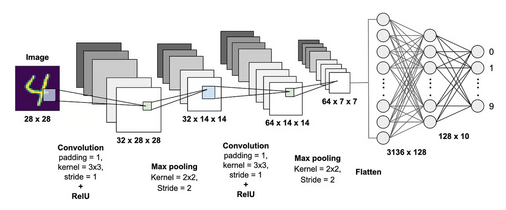

**Convolutional Neural Networks (CNNs)** are a special type of neural network designed to process **grid-like data**, such as images.

They have revolutionized the computer vision space with their high performance and efficient architecture.

They are particularly effective for image classification tasks due to their ability to capture patterns through **convolutional layers**.

Like other [[Backpropagation explained mathematically|neural networks]], CNNs are trained with **backpropagation**. A simple CNN can be seen as a stack of [[Logistic Regression|logistic regression]]-style classifiers with convolution filters.

## Why convolutions ?

## Building blocks of neural networks

