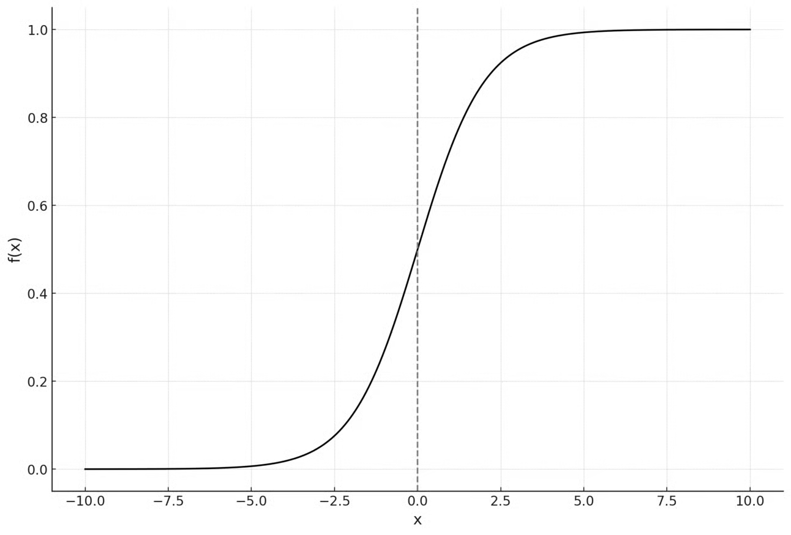

**Imagine** that you want to predict whether a student passes or fails an exam based on how many hours they studied. Your outcome is categorical: either one (pass) or zero (fail). 
We need a function that always stays between 0 and 1 to represent a valid probability. This is where the logistic function or the sigmoid function is used. The logistic/sigmoid function takes any real number and squeezes it into the range 0, 1. It is defined as the following:

$$
\sigma(z)=\frac{1}{1+e^{-z}}
$$

Its **end behaviors** are the following:

As $z \rightarrow+\infty, \sigma(z) \rightarrow 1$
As $z \rightarrow-\infty, \sigma(z) \rightarrow 0$

In machine learning applications, this function is the heart of a very popular binary classifier—**logistic regression**.

In logistic regression, we model the **probability** of the positive or true class (y=1) with the logistic or sigmoid function.

- For instance, an input of 0 (z=0) will result in a 0.5 probability from σ(z).

We can then interpret this probability into a classification using a **threshold value**, which we’ll discuss more later.

**It is recommended to have some mathematical background of multivariable calculus, probability and math notation. Without it, it may be more difficult to follow along.**

We want this model to be able to **learn from data** that we give it, allowing it to predict probabilities that will accurately classify samples. In other words, the model needs **parameters** that it can learn (e.g., β0, β1).

To do this, we wrap a **linear combination** of inputs $\left(\boldsymbol{\beta}_0+\boldsymbol{\beta}_1 \mathbf{x}_1+\ldots+\boldsymbol{\beta}_{\mathbf{n}} \mathbf{x}_{\mathbf{n}}\right)$
inside a **logistic** function.

We choose to use a **linear model** for the logistic regression since it is **easy to compute** and also **easy to interpret**—it’s what came naturally for the process.
- The portion that is actually “learned” is the linear combination, which is structurally similar to **multiple linear regression**. The combination is passed through a logistic/sigmoid function to produce a probability.

What about **neural networks**? Logistic regression can actually be considered a neural network—it is represented by a singular neuron having a sigmoid activation with no hidden layers, and it is trained with [[Backpropagation explained mathematically|backpropagation]] just like any other network.

When we actually feed our logistic regression model input data, **σ(z)** becomes 

$\sigma\left(\beta_0+\beta_1 x_1+\ldots+\beta_n x_n\right)$  where **n** represents the number of **input features**.

Thus, the **probability** (which we denote as **$p(x)$**  that a sample belongs to a given class **(y=1)** is:
$$
p(x)=\operatorname{P}(y=1 \mid x)=\sigma\left(\beta_0+\beta_1 x_1+\cdots+\beta_n x_n\right)
$$
Above, p(y = 1 | x) is read as the probability of a sample belonging to a given class given the input sequence x.

The probability p(x) can also be viewed as:
$$
p(x)=\frac{1}{1+e^{-\left(\beta_0+\beta_1 x_1+\cdots+\beta_n x_n\right)}}
$$
If p(x) is **near** **1**, the model believes a data sample belonging to a class (y=1) is **very likely**; if p(x) is **near 0**, a data sample belonging to a class (y=1) is **very unlikely**.

Now, we need to estimate the parameters β=(β0,β1,…,βn). To do that, we use **Maximum Likelihood Estimation (MLE)**.