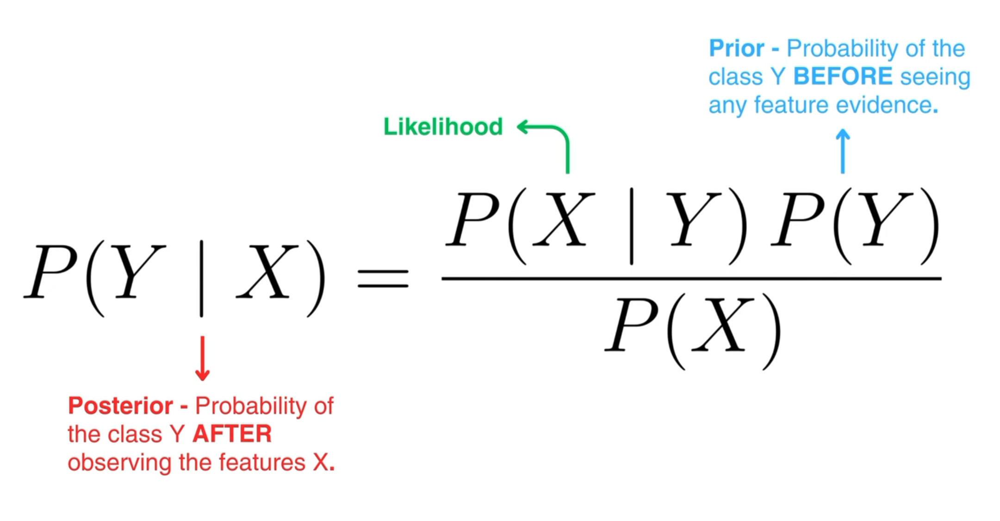

The Naive Bayes classifier is a probabilistic classifier whose goal is to calculate the probability that the target variable $Y$ belongs to an particular  class label $y$ given a set of features $X$

# The Bayes' Theorem

$$
P(Y \mid X)=\frac{P(X \mid Y) P(Y)}{P(X)}
$$
- $P(Y \mid X)$ : indicates the **posterior probability**. It is the probability of observing $Y$ given that we have **already observed** $X$ 
- $P(Y)$ : indicates the probability of observing Y **before** observing any evidence. 
- $P(X \mid Y)$ : indicates the **likelihood**
- $P(X)$ : indicates the evidence
it is called the naive Bayes classifier because it assumes that all features are independent of each other. Features can be decorrelated as a preprocessing step using [[Principal component analysis|principal component analysis (PCA)]].
Therefore we can assume the following:
$$
\begin{aligned}
P(X \mid Y) & =P\left(X_1 \mid Y\right) \cdot P\left(X_2 \mid Y\right) \cdots \cdot P\left(X_n \mid Y\right) \\
& =\prod_{i=1}^n P\left(X_i \mid Y\right)
\end{aligned}
$$
